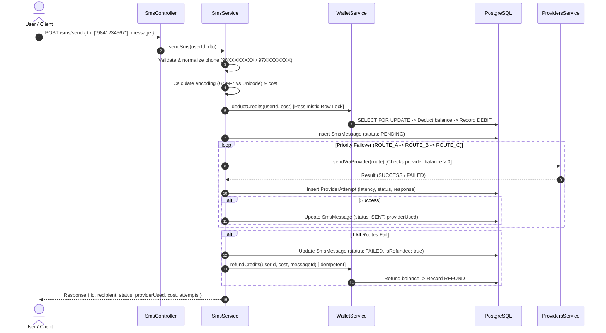

# Nest SMS Gateway

A production-grade, highly available SMS Gateway backend built with **NestJS**, **TypeORM**, and **PostgreSQL**. Features intelligent provider failover, GSM-7/Unicode segmentation, atomic concurrency control with row-level locking, and 24-hour route health observability.

---

## 🚀 Key Features

* **Authentication & Wallet Provisioning**:
  * Secure user registration & login using **bcrypt** (10 salt rounds) and **JWT**.
  * Automatic creation of a pre-funded wallet with **50 welcome credits** and an initial transaction ledger entry.
* **Domain Utilities**:
  * **Nepali Phone Normalization**: Strips `+977`/`977` and whitespace, enforcing 10-digit mobile numbers starting with `97` or `98`. Rejects invalid numbers with clear errors.
  * **SMS Segmentation Engine**: Automatically detects standard GSM-7 (160/153 characters) vs Unicode (70/67 characters for Nepali Devanagari or emojis), calculating exact message segment parts and credit costs.
* **Concurrency & Double-Debit Prevention**:
  * Atomic credit deduction using PostgreSQL **Pessimistic Row-Level Locking** (`SELECT ... FOR UPDATE`).
  * Database-level `@Check('"balance" >= 0')` constraint preventing negative balances under extreme parallel load.
  * **Idempotent Refunds**: Guarantees a failed SMS message ID can never be refunded more than once.
* **Intelligent Provider Failover Routing**:
  * Configurable multi-route cascade (`ROUTE_A` $\rightarrow$ `ROUTE_B` $\rightarrow$ `ROUTE_C`) prioritized by reliability.
  * Real-world simulation of provider latency and failure rates (`ROUTE_A`: 30%, `ROUTE_B`: 20%, `ROUTE_C`: 5%).
  * Automatically skips exhausted providers (`balance <= 0`).
  * Automatic fallback to secondary/tertiary routes and **automatic wallet refund** if all routes fail.
* **24-Hour Route Health & Observability**:
  * Real-time metrics aggregation over the last 24 hours (`GET /routes/health`).
  * Calculates balance, 24-hour delivery success rate, and composite **Health %**.
  * Operational status labels: `HEALTHY`, `DEGRADED`, `DOWN`, `IDLE`.
* **Comprehensive Testing**:
  * Unit test suite across all services and utilities (48 tests, 100% pass rate).
  * End-to-end integration and concurrency test suites.

---

## 🛠️ Tech Stack

* **Framework**: NestJS 12
* **Language**: TypeScript (ESM)
* **Database**: PostgreSQL 15 via TypeORM
* **Authentication**: Passport JWT + Bcrypt
* **Validation**: class-validator & class-transformer
* **Testing**: Vitest + Supertest
* **Containerization**: Docker & Docker Compose
* **Linter**: Oxlint

---

## 📐 System Architecture & SMS Dispatch Lifecycle



---

## 🏥 Route Health Formula (Required by Brief)

In [`GET /routes/health`](file:///Users/shubhamrajpandey/Projects/nest-sms-gateway/src/modules/routes-health/routes-health.controller.ts), each route's composite **Health %** is calculated using a weighted multi-factor formula that evaluates reliability, latency, and credit availability over the last 24 hours:

$$\text{Health \%} = (\text{SuccessRate \%} \times 0.70) + (\text{LatencyScore} \times 0.20) + (\text{BalanceScore} \times 0.10)$$

### Component Breakdown:
1. **Success Rate ($70\%$ Weight)**:
   * $\text{SuccessRate \%} = \left(\frac{\text{Successful Attempts}}{\text{Total Attempts}}\right) \times 100$
   * Directly measures upstream delivery performance.
   * If the route has had 0 attempts in the 24-hour window, it defaults to its configured baseline $(1.0 - \text{failureRate}) \times 100$.
2. **Latency Score ($20\%$ Weight)**:
   * Benchmark: $100\text{ms}$ is optimal ($100$ points).
   * Decays linearly as average latency increases toward $1,000\text{ms}$:
     $$\text{LatencyScore} = \max\left(0, 100 - \frac{\text{AverageLatencyMs} - 100}{9}\right)$$
3. **Balance Score ($10\%$ Weight)**:
   * Full score ($100$ points) if provider balance $\ge 100$ credits.
   * Scales proportionally if balance drops below $100$: $(\text{balance} / 100) \times 100$.
4. **Hard Floor**:
   * If a route is marked inactive (`isActive = false`) or its balance is exhausted (`balance <= 0`), **$\text{Health \%} = 0\%$** and its status is marked `DOWN`.

---

## 💡 Key Architectural Decisions

1. **PostgreSQL Pessimistic Locking (`pessimistic_write`)**:
   * Prevents race conditions and double-spending by acquiring a row-level `SELECT ... FOR UPDATE` lock during wallet deductions. Concurrent requests are queued at the database engine level.
2. **Database Check Constraint**:
   * Added `@Check('"balance" >= 0')` to the `wallets` table. Even if an application bug or direct database operation were attempted, PostgreSQL guarantees the balance can physically never drop below zero.
3. **Idempotent Refund Mechanism**:
   * Every refund checks `wallet_transactions` for existing entries matching the SMS `referenceId` and `type = 'REFUND'`. This guarantees that network retries or concurrent failure handlers can never refund the same message twice.
4. **Normalized Phone Format**:
   * Follows national telecommunications standards in Nepal (10 digits starting with `98` or `97`). Strips `+977` and `977` prefixes automatically while rejecting non-conforming or short numbers.
5. **Exact Segmentation Math**:
   * Enforces GSM-7 7-bit alphabet rules (160 single / 153 multipart, 2 units for extension characters like `€`, `[`, `]`) and Unicode UCS-2 rules (70 single / 67 multipart) as outlined in the brief.

---

## 📡 API Reference & Swagger UI

Interactive OpenAPI Swagger UI is available at: **`http://localhost:3000/docs`**

You can authenticate directly in Swagger UI by clicking the **Authorize** button and pasting the JWT token from `/auth/login`.

### 1. Authentication (`/auth`)

| Method | Endpoint | Description | Auth Required |
| :--- | :--- | :--- | :--- |
| `POST` | `/auth/register` | Register new user + provision wallet with 50 credits | No |
| `POST` | `/auth/login` | Authenticate and obtain JWT access token | No |
| `GET` | `/auth/me` | Fetch authenticated user profile | Yes (Bearer) |

### 2. Wallet Management (`/wallet`)

| Method | Endpoint | Description | Auth Required |
| :--- | :--- | :--- | :--- |
| `GET` | `/wallet/balance` | Get current wallet balance | Yes (Bearer) |
| `POST` | `/wallet/topup` | Top up wallet balance `{ amount: number }` | Yes (Bearer) |
| `GET` | `/wallet/transactions` | Paginated transaction audit ledger (`?page=1&limit=20`) | Yes (Bearer) |

### 3. SMS Messaging (`/sms`)

| Method | Endpoint | Description | Auth Required |
| :--- | :--- | :--- | :--- |
| `POST` | `/sms/send` | Send SMS with automatic failover. Body: `{ to: string[], message }` | Yes (Bearer) |
| `GET` | `/sms/logs` | Query sent SMS delivery logs (`?page=1&limit=20&status=SENT&number=9841234567&date=2026-10-29`) | Yes (Bearer) |
| `GET` | `/sms/:id` | Get detailed delivery attempts for a specific message | Yes (Bearer) |

### 4. Providers & Route Health (`/routes` & `/providers`)

| Method | Endpoint | Description | Auth Required |
| :--- | :--- | :--- | :--- |
| `GET` | `/providers` | List configured routes, priority, and simulated balance | Yes (Bearer) |
| `GET` | `/routes/health` | 24-hour route performance metrics (`?hours=24`) | Yes (Bearer) |

---

## ⚙️ Setup and Installation

### 1. Clone & Install Dependencies

```bash
git clone https://github.com/shubhamrajpandey/nest-sms-gateway.git
cd nest-sms-gateway
npm install
```

### 2. Environment Configuration

Copy the example `.env` file:

```bash
cp .env.example .env
```

Ensure your `.env` contains:

```ini
NODE_ENV=development
PORT=3000

DB_HOST=localhost
DB_PORT=5432
DB_USER=postgres
DB_PASSWORD=password
DB_NAME=sms_gateway

JWT_SECRET=nest_sms_gateway_secure_jwt_secret_key_2026
JWT_EXPIRATION=1d
```

### 3. Start Database via Docker Compose

```bash
docker compose up -d
```

The database automatically seeds `ROUTE_A` (30% fail), `ROUTE_B` (20% fail), and `ROUTE_C` (5% fail) on initial bootstrap.

### 4. Run the Application

```bash
# Development mode with hot-reload
npm run start:dev

# Production build & run
npm run build
npm run start:prod
```

---

## 🧪 Testing

```bash
# Run all unit tests
npm test

# Run unit tests with coverage
npm run test:cov

# Run End-to-End & Concurrency tests
npm run test:e2e

# Run linter
npm run lint
```

---

## 🔮 What I Would Improve in Production

If scaling this system to handle millions of SMS per day:
1. **Asynchronous Message Queue (BullMQ / Redis)**:
   * Move SMS dispatching into background queue workers. The `POST /sms/send` endpoint would immediately return `202 Accepted` with a job ID, allowing the gateway to ingest thousands of requests per second without tying up HTTP threads.
2. **Per-User Rate Limiting**:
   * Implement token-bucket rate limiting (e.g. 60 requests/minute per API key using `@nestjs/throttler` and Redis).
3. **Webhook Delivery Receipts (DLR)**:
   * Expose webhook receivers so upstream carriers can push asynchronous delivery acknowledgments (DELIVRD, UNDELIV, EXPIRED) directly into the gateway.
4. **Circuit Breaker Pattern**:
   * If a route fails $N$ consecutive times within 60 seconds, trip an automated circuit breaker to divert traffic immediately to secondary routes without waiting for per-request timeouts.
